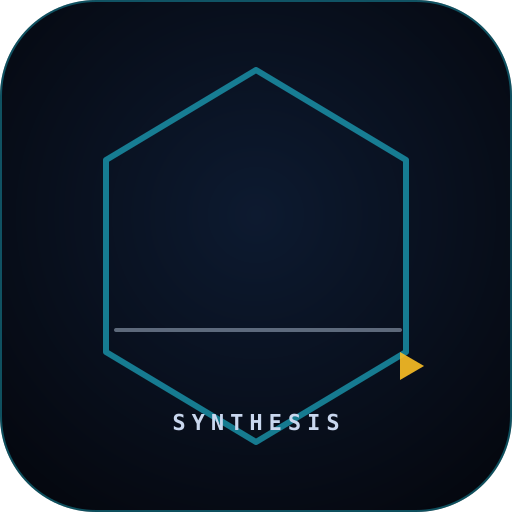
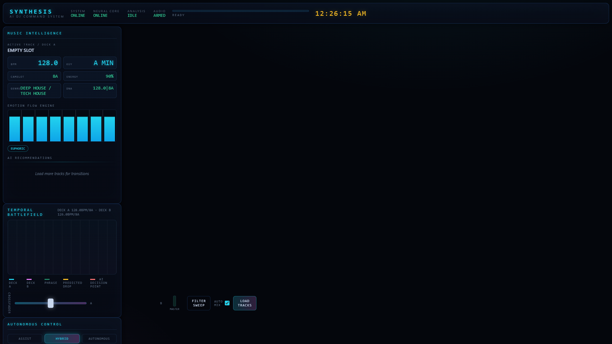
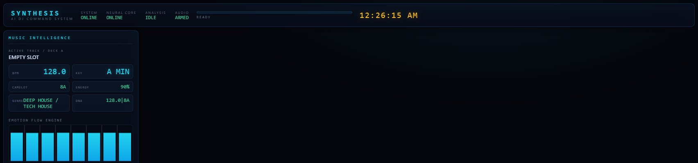

<p align="center">
  <picture>
    
  </picture>
</p>

# SYNTHESIS :: AI DJ COMMAND SYSTEM

**A military-grade autonomous music intelligence platform.** Real-time beat, key and energy analysis. AI transition direction. Autonomous mixing. Runs fully offline — no cloud, no tracking, no subscription.

<p align="center">
  <a href="LICENSE"></a>
  
  
  
  <a href="https://github.com/Nortaq-PlayNexus/synthesis-dj/actions/workflows/ci.yml"></a>
</p>

```
[ ON AIR ]  now transmitting from the synthesis decks.
```

<pre>
IDENT ......... SYNTHESIS-01
CLASS ......... AUTONOMOUS MUSIC INTELLIGENCE
STATUS ........ ON AIR / CURRENT TRANSMISSION
PLATFORM ...... ELECTRON + WEB AUDIO
DNA ........... BEAT + KEY + ENERGY + STRUCTURE
LINK .......... /synthesis-dj
</pre>

---

## // 01 :: SIGNAL

SYNTHESIS is an Electron + Web Audio DJ workstation that treats every track like a **mission target**: it decodes the waveform, extracts tempo, key, energy and structure, compiles a compact **Music DNA** fingerprint per song, then runs an in-browser AI Transition Director that decides *when* and *how* to move between decks.

Everything runs locally. The optional **Neural Advisor** can stream tactical narratives from any OpenAI-compatible endpoint (OpenRouter, local Ollama, etc.) — but it's never required.

```
        ┌───────────┐     ┌────────────┐     ┌─────────────────┐
 DECK A │  DECODE   │────▶│  MUSIC DNA │────▶│  TRANSITION     │
        └───────────┘     └────────────┘     │  DIRECTOR (AI)  │
                                             └────────┬────────┘
        ┌───────────┐                                  │  decide when
 DECK B │  DECODE   │──▶  BEAT · KEY · CAMELOT · ENERGY│  & how to move
        └───────────┘                                  ▼
                                             ┌─────────────────┐
                                             │  CROSSFADER     │
                                             │  AUTONOMOUS MIX │
                                             └─────────────────┘
```

---

## // 02 :: CAPABILITIES

- **Beat Intelligence** — onset detection, autocorrelation + comb-based BPM estimation, phase alignment, full beat grid per track.
- **Harmonic Intelligence** — Krumhansl–Schmuckler key detection with Camelot wheel codes for instant harmonic compatibility scoring.
- **Emotion Flow Engine** — per-beat energy profiling, predicted drop points, human-readable emotional profile per track.
- **Music DNA** — every analysis compiles into a compact signature string letting the AI compare tracks and predict smooth transitions.
- **AI Transition Director** — phrase mixing, drop alignment, energy breakdown decisions with an action list and confidence score.
- **Autonomous Modes** — `ASSIST`, `HYBRID`, full `AUTONOMOUS` with a live crossfader, beat-synced decks, EQ stem matrix, FX bus, jog wheels.
- **Playlist Queue** — ordered set roster, reorder/remove controls, optional auto-advance, persisted across restarts.
- **Crowd Intelligence** — analyzes a whole set library and reports average BPM, peak-engagement track, evolving set storyline.
- **Optional LLM Advisor** — bring-your-own-key chat-completions endpoint for elite-level narration and set guidance.

---

## // 03 :: THE COMMAND CENTER

| Command Center | Autonomous Mix |
|:---:|:---:|
|  |  |

| Command Bar |
|:---:|
|  |

> Screenshots are generated from real render passes (`npm run screenshots`). See [docs/development.md](docs/development.md).

---

## // 04 :: SETUP // POWER ON

```bash
$ git clone https://github.com/Nortaq-PlayNexus/synthesis-dj.git
$ cd synthesis-dj
$ npm ci
$ npm start
```

Requires **Node.js 18+** and a desktop platform with a working Chromium sandbox (Windows, macOS or Linux).

---

## // 05 :: QUICK TOUR

1. Click **LOAD TRACKS** (or `Ctrl/Cmd+O`) and pick one or more audio files (mp3, wav, ogg, flac, m4a, aac, aiff, ...).
2. SYNTHESIS analyzes each track and reports BPM, key, Camelot code, energy, genre guess and Music DNA in the **MUSIC INTELLIGENCE** panel.
3. Every analyzed track lands in the **PLAYLIST QUEUE** — reorder with ▲/▼, remove with ✕, or hit **▶** to load it on a deck. The queue survives restarts.
4. The **AI RECOMMENDATIONS** list ranks the best harmonic/BPM matches for what's loaded on Deck A.
5. Flip **AUTO MIX** on (or select AUTONOMOUS mode) and let the Transition Director drive the crossfader at phrase ends, predicted drops, and energy breakdowns.
6. Keep **AUTO ADVANCE** enabled and the playlist rolls forward when a deck finishes.
7. Optional: open **NEURAL ADVISOR**, enter an OpenAI-compatible endpoint + key, get tactical DJ advice.

---

## // 06 :: CONSOLE COMMANDS (SCRIPTS)

| Script | Purpose |
|---|---|
| `npm start` | launch the app |
| `npm run smoke` | headless smoke test of the analysis engine inside Electron |
| `npm test` | Vitest unit + integration suite |
| `npm run lint` / `npm run format` | enforce ESLint + Prettier |
| `npm run screenshots` | regenerate real UI screenshots |
| `npm run assets` | regenerate screenshots + logo render |
| `npm run dist` / `dist:win` | build distributable installers (electron-builder) |
| `npm run verify` | lint + format + tests + smoke, all in one |

---

## // 07 :: INTERNAL WIRING (TECH STACK)

- **Runtime** — Electron (Chromium + Node)
- **Audio engine** — Web Audio API (`AudioContext`, `AudioBufferSourceNode`, BiquadFilter, Convolver, Delay, custom FX graphs)
- **Analysis** — vanilla ES-module DSP (FFT, autocorrelation, onset envelopes, Krumhansl key profiles)
- **AI layer** — deterministic scoring (Camelot, BPM ratio, energy flow) plus optional chat-completions narration
- **Tooling** — Vitest, ESLint (flat config), Prettier, electron-builder
- **Security** — `contextIsolation: true`, `nodeIntegration: false`, sandboxed preload bridge, strict CSP in `index.html`

---

## // 08 :: ARCHIVE // DOCS

<details>
  <summary><code>$ ls docs/ - FULL MANIFEST</code></summary>

- [Getting started](docs/getting-started.md)
- [Architecture](docs/architecture.md)
- [Analysis engine](docs/analysis-engine.md)
- [AI engine](docs/ai-engine.md)
- [API reference](docs/api.md)
- [Development guide](docs/development.md)
- [Deployment & packaging](docs/deployment.md)
- [Diagrams](docs/diagrams.md)

</details>

<details>
  <summary><code>$ ls repository/ - PROJECT MANIFEST</code></summary>

- [Contributing](CONTRIBUTING.md)
- [Code of Conduct](CODE_OF_CONDUCT.md)
- [Security policy](SECURITY.md)
- [Roadmap](ROADMAP.md)
- [Changelog](CHANGELOG.md)

</details>

---

## // 09 :: LEGAL

**License:** [MIT](LICENSE) © Nortaq-PlayNexus

---

```
 ┌─────────────────────────────────────────────┐
 │  NOW TRANSMITTING // SYNTHESIS DECKS        │
 │  BEAT · KEY · ENERGY · CROWD // NO CLOUD   │
 └─────────────────────────────────────────────┘
END OF TRANSMISSION
```